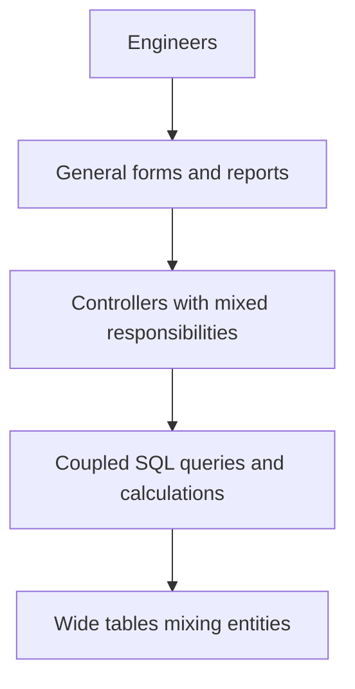
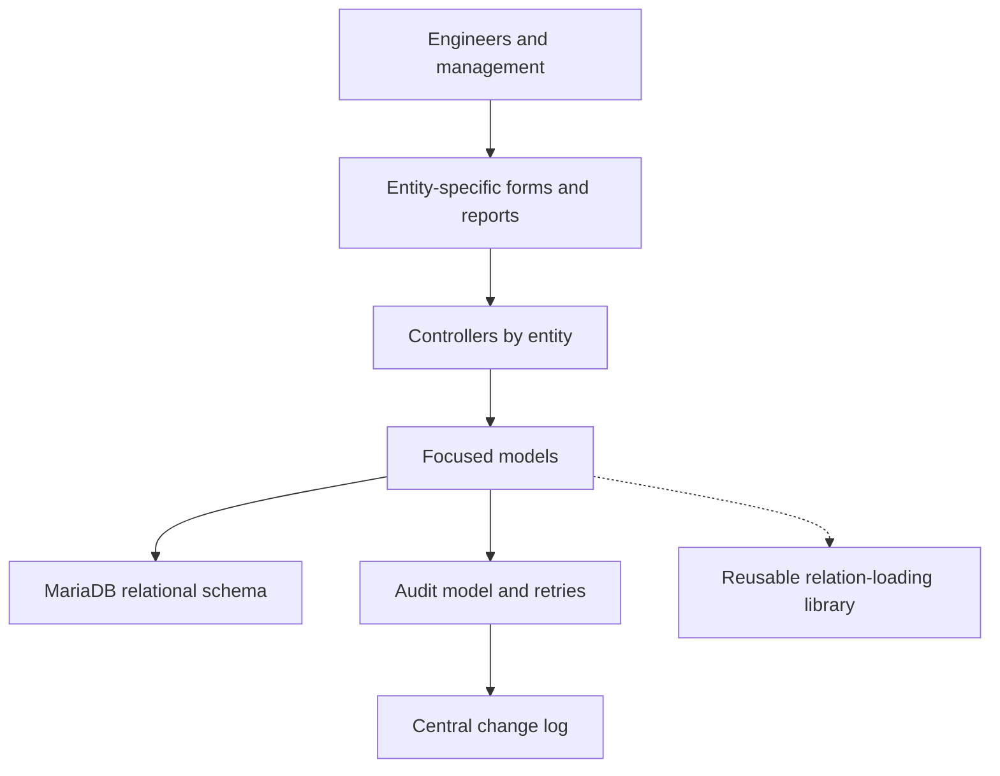
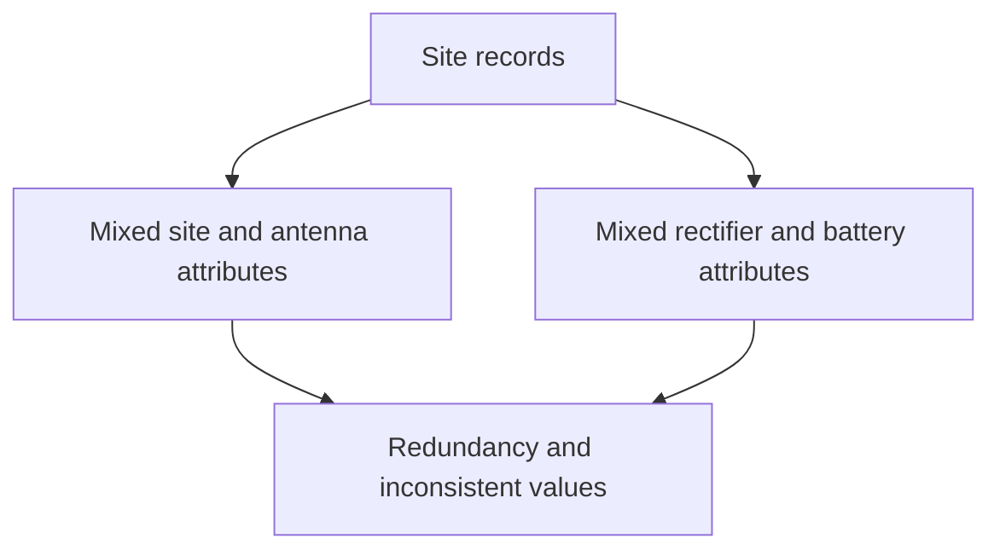
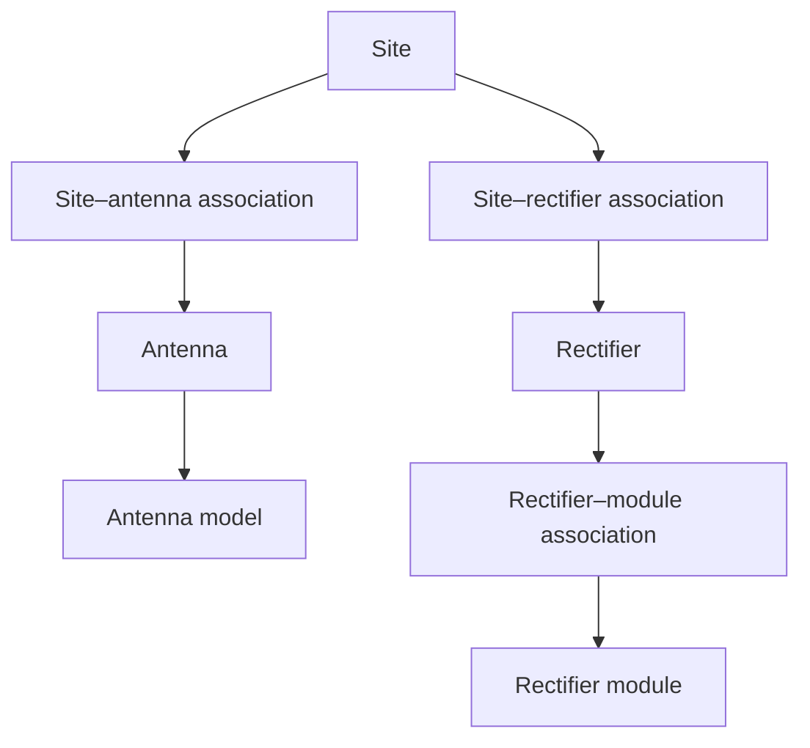

# Legacy Enterprise Application Refactoring — Architecture Case Study

**Modernizing a telecommunications operations platform through relational database redesign, MVC refactoring, and improved data integrity.**

This case study describes work I performed on an ERP-like enterprise application supporting telecommunications maintenance operations, infrastructure management, and budget reporting. It was a specialized operations platform, not a company-wide ERP suite. I inherited a system that required recurring manual data corrections, had inconsistent reports, and was difficult to maintain. I investigated its business rules, redesigned the relational data model, rebuilt key application flows, and later improved the separation of responsibilities across the MVC layers.

The outcome was a platform that, based on my direct observations at the time, became more reliable for daily work and easier to extend. I do not have the historical telemetry required to quantify latency reductions, error rates, or adoption growth.

> **Confidentiality:** This is an illustrative reconstruction of my experience, not an export or reproduction of a client system. Organization names, table names, sample relationships and diagrams have been generalized. No proprietary code, credentials, real records or internal endpoints are included.

## At a glance

- **Domain:** Telecommunications operations, field maintenance and capital/operating expenditure reporting.

- **My role:** Individual developer responsible for the initial investigation and reconstruction, later evolving the same application as responsibilities expanded.

- **Period:** Work began around late 2015; this case focuses on changes I implemented directly during my employment, not later changes made by other engineers.

- **Stack:** PHP, CodeIgniter, MariaDB, HTML/CSS, JavaScript, jQuery, Bootstrap, and selected AngularJS 1.x components.

- **Core challenges:** Mixed data entities, weak validation, coupled controllers, inconsistent reporting, limited traceability, and no independent development/UAT environment.

- **Focus areas:** Relational design, SQL migration, MVC refactoring, data integrity, auditing, operational constraints and technical trade-offs.

## 1. Context and problem

I originally joined the engineering-services company as a transmission engineer. Because I also had web development and database experience, I later took responsibility for an operations and maintenance portal when its previous developer left. The handover was brief, and the expected assignment was initially to correct data and keep the portal operational.

The recurring incidents exposed deeper structural issues. Some numeric values were stored as text. Wide tables mixed attributes belonging to different infrastructure entities. Controllers handled multiple unrelated responsibilities, and unused views and commented-out code made changes harder to understand. Users could enter different textual representations of the same equipment model, resulting in inconsistent records. Reports occasionally omitted information or returned unexpected values.

The system supported field-maintenance records, equipment information, and OPEX/CAPEX reporting. The challenge was to restore confidence in an application that engineers depended on, without disrupting the existing operation.

## 2. Constraints

There was no separate development, staging or UAT environment. I had limited access within the application directory on the production server and no authority to install additional server components without a lengthy approval process. I therefore kept the existing PHP/CodeIgniter stack and used a subpath of the application plus a redesigned database to develop the next version. This was a pragmatic response to the environment, **not** a genuinely isolated test setup or a deployment pattern I would recommend today.

I also performed the initial cutover before obtaining explicit approval from my supervisor. It succeeded operationally, but this was a change-management mistake; a modern approach should secure authorization, an independently validated backup, a tested rollback plan and an isolated environment.

## 3. Architecture: before and after

### Application structure — before

This diagram summarizes the coupling I observed. It does not imply that the original system had literally one controller or one table.

### Application structure — after

The transition happened in stages: first I separated entities, controllers and forms; months later I improved how models and controllers shared responsibility and extracted reusable relation-loading functionality.

### Data model — before

### Data model — after

All table and association labels are synthetic. The diagrams illustrate distinct entities and dedicated association tables, not a verified physical schema with exact foreign-key directions or cardinalities. Additional equipment categories existed but are omitted for readability.

## 4. Five engineering decisions

### Decision 1 — Redesign the relational model and enforce integrity

I created separate tables for entities and dedicated association tables for their relationships. I introduced auto-incrementing identifiers, foreign keys, uniqueness rules for applicable serial numbers, non-null requirements, and validation at the database, backend and frontend levels. This addressed recurrent errors more fundamentally than continuing to fix bad rows one by one.

**Trade-off:** Migration and data reconciliation became substantial work, especially when historical serial numbers and equipment records were ambiguous. More normalized relations can also introduce additional joins; normalization alone does not guarantee faster queries.

### Decision 2 — Reconstruct under constrained infrastructure

I rebuilt the application alongside the old version, while the legacy application continued receiving operational data. For cutover, I selected an out-of-hours window, disabled access through the old interface, ran the prepared SQL migration against the latest source data and activated the new version. I retained the previous version for a limited period as a possible fallback and comparison point.

**Trade-off:** Both versions still shared production infrastructure. The legacy portal had no enabled APIs or other known application interfaces for writing data. Very few people knew the system well, and usage was limited even within its department. I selected an out-of-hours window and disabled the only user-facing interface; to my knowledge, there were no writes during the cutover. I no longer have an independent backup or formal rollback evidence. Even with that low usage and restricted access, sharing production infrastructure remained a risk. In retrospect, an authorized cutover, isolated staging environment, tested backups and restoration rehearsals would be essential.

### Decision 3 — Refactor controllers, then improve MVC separation

In the first reconstruction I separated controllers and forms by entity and removed unused code. Later, after studying Sails.js to better understand MVC, I moved more specific data-access responsibility into models and used CodeIgniter's query facilities when appropriate. For optional loading of related data, I implemented a populate-like helper and ultimately extracted it into a shared library.

**Trade-off:** The initial reconstruction required substantial functional validation to prevent regressions. The later abstractions improved my ability to extend the application, but additional layers and relation loading also require care to avoid unnecessary database requests. I did not migrate the portal to Sails.js.

### Decision 4 — Introduce auditability and three-layer validation

I added stronger input rules, backend validation and database constraints. A central history table stored the entity, record identifier, user, timestamp and a text column containing JSON with the changed fields and their old/new values. The history covered record creation, updates and soft deletion, with a TINYINT flag retaining deleted records. Users could see who last changed a value and when, but did not browse the full audit log.

The primary data write and subsequent history write were independent operations. I encountered occasional failures of the history insert and implemented retries, which addressed the losses I observed.

**Trade-off and lesson:** Retries were a useful mitigation, not a guarantee of atomicity. A persistent failure could still leave a committed change without its audit entry. Today I would evaluate a shared transaction or an appropriate transactional event pattern, depending on requirements.

### Decision 5 — Make SQL more selective and reporting more useful

I reduced unnecessary selected columns and joins, pushed suitable aggregations into SQL, and limited the amount of data sent to controllers. I used MySQL Workbench to compare query execution during development. For extensive equipment lists, logs and reports, I also organized complex queries using SQL views. New entity-specific forms and managerial reports supported evolving workflows.

**Trade-off:** Hand-written reporting SQL still requires maintenance and query-plan review; standard SQL views do not inherently improve performance. I observed faster queries, but do not have the historical execution times needed for a quantified claim.

## 5. Validation and migration outcomes

I prepared functional notes during my investigation and used them as a manual test reference. I reviewed workflows and data relationships with engineers familiar with the equipment, compared reports between versions for a limited period, and wrote SQL checks to identify rows that failed to migrate. The new version went live with most records transferred; a smaller subset of ambiguous historical data, particularly fuel tanks and rectifiers, required ongoing manual reconciliation with users. Some records remained pending for weeks or months because those assets changed infrequently.

The following outcomes are qualitative observations from my direct experience, **not independently audited metrics**:

- Fewer recurring manual corrections were needed for the workflows I maintained.

- Engineers increasingly trusted recorded values and reporting outputs.

- Members of the operations team used the portal more consistently for daily work, reducing reliance on spreadsheets for some processes.

- Field-level last-editor information made it easier to identify whom to contact when a record appeared incorrect.

- More focused controllers, models and reports made later features easier to add and maintain.

I do not claim a measured percentage improvement in performance, an exact defect reduction, or verified adoption figures. Additional colleague testimony may be added later if available.

## 6. What I would do differently today

1. Obtain approval and agree on maintenance windows before a production cutover.

2. Use a separate test environment, automated regression checks, a validated backup and a practiced rollback plan.

3. Plan migration mapping, data-quality exceptions and reconciliation as explicit deliverables, with documented acceptance criteria.

4. Make audit persistence guarantees explicit and use transactions or reliable event patterns rather than relying on retries alone.

5. Define baseline metrics for query latency, data-quality defects, adoption and report accuracy before claiming quantified improvements.

## 7. Evidence and scope

This case is based on my professional recollections documented through retrospective interviews, a conceptual sketch I provided, and a historical screenshot of a reporting interface. The sketch and screenshot are not republished here because their provenance and disclosure permissions have not been independently verified. These diagrams are synthetic and illustrative. No original repository, database dump, API credentials, internal documents or client records are included.

My employment and later consulting work involved other systems, but this case intentionally covers my direct contributions to the inherited operations and maintenance portal. Features later built by other developers are not attributed to me.

---

*Illustrative reconstruction of professional experience. All organization identifiers, diagrams and examples are generalized. No proprietary implementation is disclosed.*
